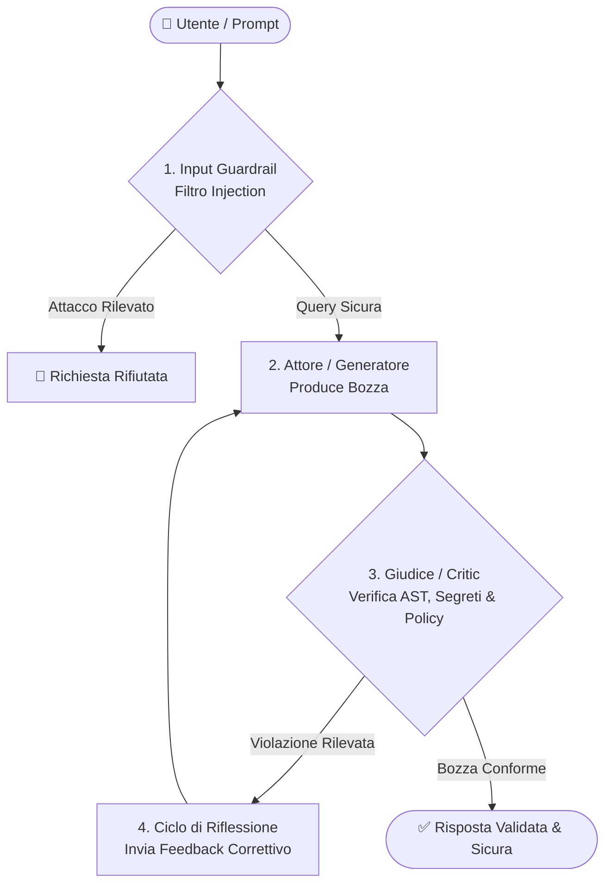

# Ciao, sono Gabriel 👋
### AI-Augmented Developer | AI Coding & Agentic Workflows

[](https://linkedin.com)
[](https://github.com/gaabriel399)

Sviluppo progetti e soluzioni software pilotando agenti e strumenti avanzati di intelligenza artificiale (**Antigravity**, **Claude Code**, **OpenAI Codex**, **Cursor**, **Windsurf**).  
Focalizzato sulla progettazione dell'architettura software, definizione di **Guardrail di Sicurezza**, governance delle regole per gli agenti e validazione deterministica del codice prodotto.

---

## 🛡️ Progetto in Evidenza: Self-Correcting LLM Guard & Evals

<p align="center">
  <a href="https://github.com/gaabriel399/self-correcting-llm-guard">
    
  </a>
</p>

[](https://www.python.org/)
[](https://github.com/gaabriel399/self-correcting-llm-guard)
[](https://github.com/gaabriel399/self-correcting-llm-guard)
[](https://github.com/gaabriel399/self-correcting-llm-guard)
[](https://github.com/gaabriel399/self-correcting-llm-guard)

> **Sistema Universale di Auto-Correzione (Reflection Pattern) e Guardrail di Sicurezza per qualsiasi Editor, IDE e AI Agent.**  
> Funziona nativamente con **OpenAI Codex**, **Cursor**, **Windsurf**, **VS Code** (Copilot/Cline), **Claude Code**, **Antigravity**, terminale CLI e pipeline CI/CD. Intercetta in tempo reale allucinazioni su policy aziendali, errori di sintassi AST, segreti hardcoded e operazioni a rischio prima della consegna all'utente.

### ⚡ Installazione Rapida in 1 Secondo (1-Click Install)

Apri PowerShell all'interno della cartella del tuo progetto e incolla questo singolo comando:

```powershell
irm https://raw.githubusercontent.com/gaabriel399/self-correcting-llm-guard/main/install.ps1 | iex
```

> 💡 **Zero Configurazione**: Lo script configura istantaneamente regole e hook per **Codex**, **Cursor** (`.cursorrules`), **Windsurf** (`.windsurfrules`), **Claude Code** (`CLAUDE.md`), **VS Code** e **Antigravity** (`.agents/`).

---

### 📌 Perché ho creato questo progetto?

Nei moderni ambienti di sviluppo assistiti dall'AI, i modelli linguistici possono commettere errori critici:
- **Allucinazioni & Policy Breach**: Inventare condizioni commerciali fuori policy (sconti non autorizzati, tempistiche di reso errate).
- **Fuga di Credenziali (Zero Leaks)**: Proporre codice contenente token privati o chiavi API in chiaro anziché variabili d'ambiente protette.
- **Errori Sintattici (Broken AST)**: Generare codice con parentesi non chiuse, indentazione errata o JSON malformato non eseguibile.
- **Prompt Injection & Comandi Rischiosi**: Subire manipolazioni del prompt o suggerire comandi di cancellazione non circoscritti.

Questo progetto implementa una **pipeline universale, deterministica e verificata** che costringe l'AI ad auto-analizzarsi (*Reflection Pattern*) e correggersi prima che la risposta raggiunga lo sviluppatore.

---

### 🏗️ Architettura del Sistema

<p align="center">
  
</p>

La pipeline opera attraverso 5 fasi coordinate:
1. **Input Shield & Security Guardrail**: Rileva istantaneamente tentativi di prompt injection e input malevoli.
2. **Generatore / Draft Engine (Attore)**: Produce la prima bozza di codice o risposta.
3. **Giudice / Critic (Ispezione AST & Policy)**: Valida la sintassi del codice (AST), verifica le credenziali e confronta la risposta con le regole ufficiali (`knowledge_base.json`).
4. **Ciclo di Riflessione & Auto-Correzione**: Se il Giudice rileva un'infrazione, inietta feedback correttivo all'Attore guidando la riscrittura conforme.
5. **Output Validato**: Consegna all'utente codice testato, sicuro e privo di allucinazioni con relativo badge di trasparenza.



---

### 📸 Dimostrazione Live & Auto-Correzione

<p align="center">
  
</p>

Quando il guardrail intercetta una vulnerabilità o un'incongruenza, applica l'auto-correzione ed espone in modo trasparente il badge di verifica:

> 🛡️ **[Guardrail Attivo - Auto-Correzione Applicata]**
> * **Rischio / Violazione intercettata:** Rilevata chiave API hardcoded nel blocco di codice generato.
> * **Intervento:** Riscrittura sicura del codice tramite `os.environ.get('API_KEY')` con validazione AST superata.

---

### 🌐 Supporto Universale: Qualsiasi Editor & Qualsiasi Agente

| Ambiente / Editor | Modalità di Integrazione | File di Configurazione |
| :--- | :--- | :--- |
| **OpenAI Codex / Codex CLI** | Direttive prompt, wrapper Python e validazione output | [`CODEX.md`](https://github.com/gaabriel399/self-correcting-llm-guard/blob/main/CODEX.md) |
| **Cursor** | Regole di progetto per l'AI Agent | [`.cursorrules`](https://github.com/gaabriel399/self-correcting-llm-guard/blob/main/.cursorrules) |
| **Windsurf** | Regole di contesto per Cascade | [`.windsurfrules`](https://github.com/gaabriel399/self-correcting-llm-guard/blob/main/.windsurfrules) |
| **Claude Code** | Istruzioni per Claude CLI & Agent | [`CLAUDE.md`](https://github.com/gaabriel399/self-correcting-llm-guard/blob/main/CLAUDE.md) |
| **VS Code (Copilot / Cline / Roo)** | Regole di workspace e pre-commit | [`.github/copilot-instructions.md`](https://github.com/gaabriel399/self-correcting-llm-guard/blob/main/.github/copilot-instructions.md) |
| **Antigravity / Agentic IDEs** | Regole attive, Skill e Lifecycle Hooks | [`.agents/rules/AGENTS.md`](https://github.com/gaabriel399/self-correcting-llm-guard/blob/main/.agents/rules/AGENTS.md) |
| **Terminale & Pipeline CI/CD** | Suite automatizzata di Evals e CLI interattiva | [`main.py`](https://github.com/gaabriel399/self-correcting-llm-guard/blob/main/main.py) |

---

### 💬 Gestione Policy da Chat (Zero-Touch)

Non serve modificare a mano i file JSON. Se scrivi in chat all'editor:
- *"Aggiungi una regola: il limite di reso è di 30 giorni per acquisti con scontrino"*
- *"Rimuovi la regola sul limite di reso"*
- *"Quali regole abbiamo attive?"*

L'agente aggiorna dinamicamente la knowledge base locale e conferma con il badge dedicato:
> 🛡️ **[Policy Aggiornata con Successo da Chat]**
> * **Nuova Regola Registrata:** Regola registrata e validata.
> * **Stato:** Attiva e salvata nel progetto.

---

### 🔒 Privacy & Sviluppo Locale (Isolamento Totale)

Se utilizzi la protezione su progetti di lavoro o aziendali e desideri mantenerla **esclusivamente sul tuo PC**, basta aggiungere i file a `.git/info/exclude`:

```powershell
Add-Content -Path .git/info/exclude -Value "`ncode_guard.py`nguardrail_critic.py`nknowledge_base.json`nmodels.py`nscripts/`n.agents/`n.cursorrules`n.windsurfrules`nCLAUDE.md`nCODEX.md"
```

In questo modo i file della skill rimangono sempre attivi in locale ma non appariranno mai nel git status o nei commit della repository aziendale.

🔗 **Esplora il repository completo:** [gaabriel399/self-correcting-llm-guard](https://github.com/gaabriel399/self-correcting-llm-guard)

---

## 🛠️ Il Mio Workflow di Sviluppo (AI-Augmented Stack)

* **AI Coding Orchestration:** Antigravity, Claude Code, OpenAI Codex, Cursor, Windsurf
* **Supervisione & Architettura:** Requisiti di progetto, prompt strutturati, regole di contesto (`.cursorrules`, `rules/AGENTS.md`, `CLAUDE.md`, `CODEX.md`)
* **Qualità & Validazione:** Python, Pytest, AST Syntax Checking, Git & GitHub
* **Deployment & Automazione:** PowerShell, Scripting di automazione, CI/CD

---

## 📈 Attività GitHub

<p align="center">
  
  
</p>
